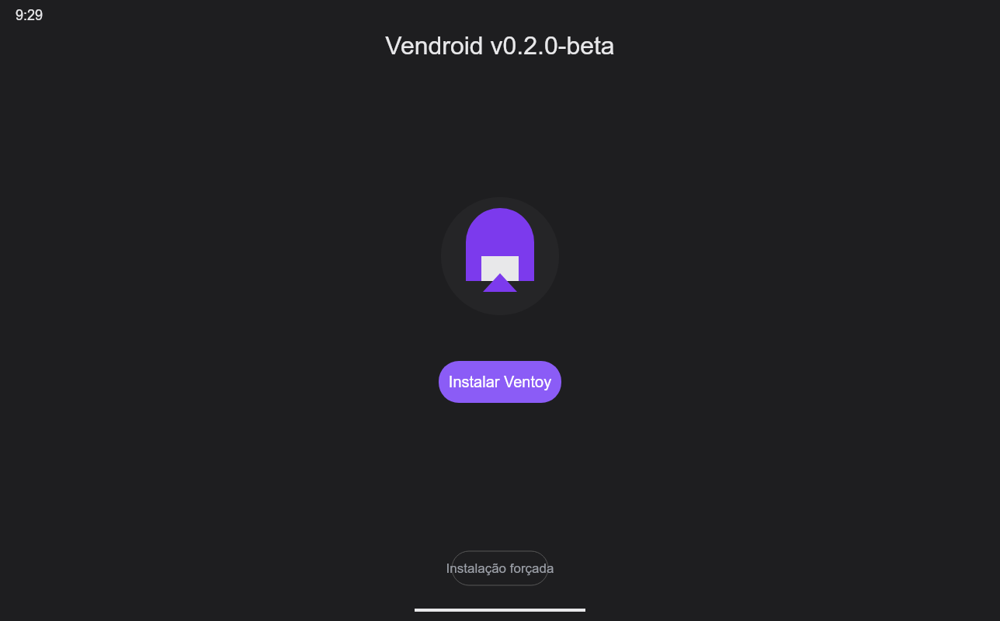
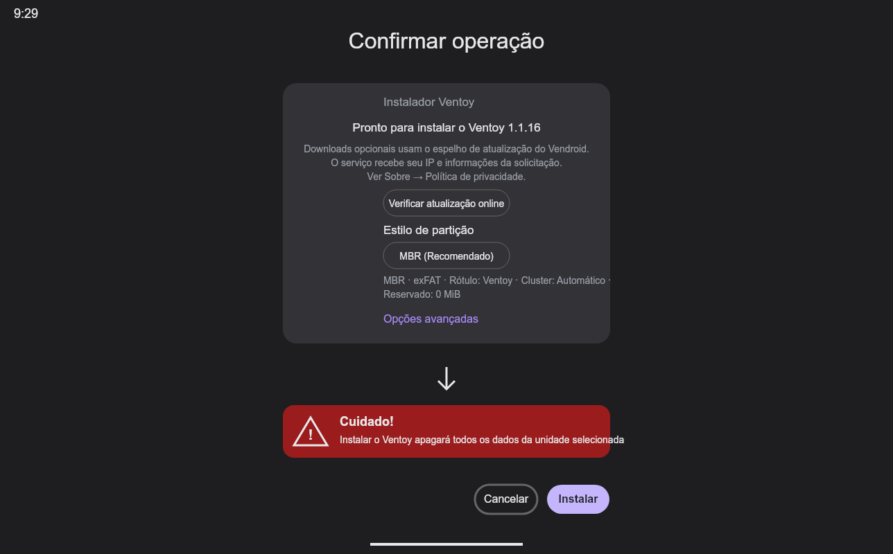
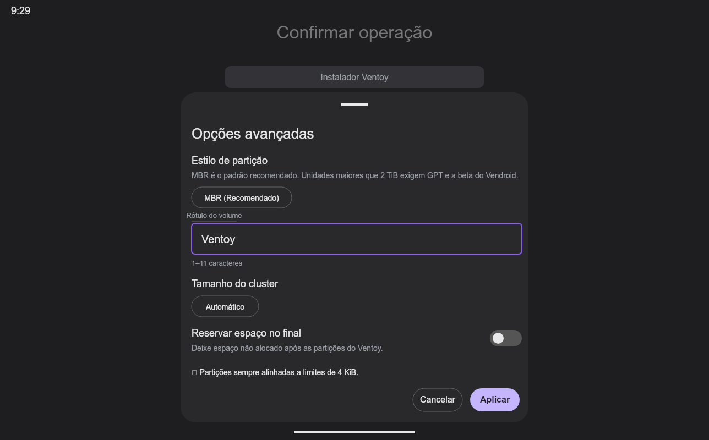

<p align="center">
  
</p>

<h1 align="center">Vendroid</h1>

<p align="center">
  Coloque o <a href="https://www.ventoy.net">Ventoy</a> em um drive USB usando seu celular Android.<br>
  Sem root. Sem PC.
</p>

<p align="center">
  <a href="https://github.com/RamonMods/Vendroid/releases"></a>
  <a href="https://github.com/RamonMods/Vendroid/actions/workflows/build-test-debug.yml"></a>
  <a href="#google-play-beta"></a>
  
  <a href="LICENSE"></a>
</p>

<p align="center">
  <a href="https://pixgg.com/ramon"></a>
</p>

<p align="center">
  <a href="#download-and-install">Baixar</a> ·
  <a href="#how-it-works">Como funciona</a> ·
  <a href="#limitations">Limitações</a> ·
  <a href="#faq">FAQ</a> ·
  <a href="https://vendroid.ramonmods.com">Site</a>
</p>

---

Seu PC não dá o boot e o único computador funcionando por perto é o seu celular. O Vendroid transforma
um drive USB em um drive multiboot do [Ventoy](https://www.ventoy.net) direto do Android.
Instale o Ventoy uma vez, copie os arquivos ISO para o drive e escolha um no menu do Ventoy quando
o computador iniciar.

> [!WARNING]
> Instalar o Ventoy apaga todo o drive USB. Faça um backup antes e mantenha o drive
> conectado até o Vendroid avisar que terminou.

**Status:** a versão 0.2.0 está em beta. A versão estável 0.2.0 sai assim que os testes em um
drive físico forem concluídos.

<a id="screenshots"></a>

## Capturas de tela

<p align="center">
  <a href="docs/images/home.png"></a>
  <a href="docs/images/install-confirmation.png"></a>
  <a href="docs/images/install-options.png"></a>
</p>

Estas são telas reais da beta 0.2.0. Os testes automatizados as capturam em uma
máquina virtual Android do tamanho de um tablet com um drive USB virtual. Celulares mostram as mesmas telas
em layout retrato. Veja [docs/images](docs/images/README.md) para saber de onde elas vêm.

<a id="features"></a>

## Recursos

- **Instalar o Ventoy** em um drive USB com uma partição de dados exFAT.
- **Detectar** um drive Ventoy existente e mostrar a versão instalada.
- **Atualizar** um drive Ventoy mais antigo. Apenas as partes de boot são substituídas, e seus arquivos permanecem.
- **Reparar** um drive Ventoy que já tem a mesma versão, novamente sem tocar em seus arquivos.
- **Recusar downgrades.** O Vendroid não substitui uma versão mais recente ou desconhecida do Ventoy pela sua.
- **Funcionar offline.** Os arquivos oficiais do Ventoy 1.1.18 são incluídos e verificados por SHA-256 antes do uso.
- **Atualização online opcional.** O Vendroid pode baixar um pacote oficial mais recente do Ventoy do seu espelho de atualização, verificar o SHA-256 e mantê-lo para uso offline posterior.
- **Opções de instalação:** rótulo do volume, tamanho do cluster (automático ou de 32 a 256 KiB) e espaço não alocado reservado no fim do drive. As partições são alinhadas a 4 KiB.
- **Verificar o próprio trabalho.** O Vendroid sincroniza o drive e relê o que gravou antes de reportar sucesso.
- **Sem root.** O Vendroid se comunica com o drive pela API USB host do Android depois que você concede a permissão USB.
- **Sem anúncios, contas ou analytics.** Veja a [política de privacidade](docs/privacy-policy.md).
- Inglês e árabe, temas claro e escuro.

O Vendroid não copia arquivos ISO por você. Use um computador ou um gerenciador de arquivos no seu celular
que consiga abrir o drive.

<a id="how-it-works"></a>

## Como funciona

1. **Acesso USB direto.** O Android permite que um app se comunique diretamente com um dispositivo USB assim que você autoriza.
   O Vendroid usa o [libaums](https://github.com/magnusja/libaums) com um driver SCSI adaptado para ler e gravar os setores do drive. O Android nunca precisa montar o drive, então root não é necessário.
2. **O layout do Ventoy.** O Vendroid grava o layout que o Ventoy espera: uma partição exFAT grande para seus arquivos e uma partição `VTOYEFI` de 32 MiB no fim do drive. MBR é a tabela de partição recomendada, e GPT também está disponível.
3. **Arquivos de boot oficiais.** O código de boot e a imagem `VTOYEFI` vêm do pacote Linux oficial do Ventoy. O build fixa a versão, e o app verifica o SHA-256 de cada arquivo.
4. **Seu próprio formatador exFAT.** O Vendroid formata a partição de dados ele mesmo. A CI verifica o resultado com `fsck.exfat`.
5. **Sincronizar e verificar.** O Vendroid pede ao drive para sincronizar o cache, depois relê a tabela de partições e os arquivos de boot e os compara.

Toda alteração é testada no GitHub Actions em uma máquina virtual Android com drives USB virtuais:
instalação, reconexão, atualização, reparo e o boot de um ISO de teste com firmware BIOS e UEFI.
Veja o [guia de validação](docs/validation.md).

<a id="download-and-install"></a>

## Baixar e instalar

Você precisa:

- Um dispositivo Android 6.0 ou mais recente com suporte a USB host (OTG).
- Um drive USB e um adaptador USB-C ou micro-USB, caso o drive não caiba no seu celular.

<a id="github-releases"></a>

### GitHub Releases

1. Abra [Releases](https://github.com/RamonMods/Vendroid/releases) e baixe o `vendroid-v<version>.apk` mais recente. Builds marcados como **Pre-release** são betas.
2. Abra o APK no seu celular e permita a instalação quando o Android pedir.

Para conferir o download, compare-o com o arquivo `.sha256` publicado ao lado:

```sh
sha256sum -c vendroid-v<version>.apk.sha256
```

Toda versão é assinada com a mesma chave. `apksigner verify --print-certs` mostra este
SHA-256 do certificado:

```text
b388ad9d2290967480630cbd4a48f4f8c6784305c05da3541ad780821d9fbeb1
```

<a id="google-play-beta"></a>

### Beta no Google Play

O Vendroid está em teste fechado no Google Play. Para participar:

1. Entre no [vendroid-beta-testers](https://groups.google.com/g/vendroid-beta-testers)
   Google Group com a conta Google que você usa no celular.
2. Abra a [página de adesão](https://play.google.com/apps/testing/io.github.ramonmods.vendroid),
   aceite e instale o Vendroid pelo Google Play.

A beta e a versão estável são o mesmo app, então a beta substitui uma instalação estável.

<a id="use-it"></a>

### Como usar

1. Conecte o drive USB e abra o Vendroid.
2. Toque em **Instalar Ventoy**, escolha o drive e toque em **Conceder acesso**.
3. Confira o nome do drive. Abra **Opções avançadas** se quiser alterar o rótulo, o tamanho do cluster
   ou o espaço reservado.
4. Toque em **Instalar**. O Vendroid pede que você deixe o celular deitado para que o conector não se mova.
   Aguarde a tela de sucesso.
5. Copie seus arquivos ISO para o drive, conecte-o ao computador e dê o boot pelo USB.

Se o drive já tiver partições, o Vendroid para. Volte e escolha **Instalação forçada** para apagá-lo. Se o drive
já tiver o Ventoy, a tela de confirmação oferece **Atualizar** ou **Reparar** em vez de **Instalar**, e seus arquivos
são mantidos.

<a id="limitations"></a>

## Limitações

- **Apenas drives USB.** O slot de cartão SD embutido no celular não é compatível.
- **MBR é recomendado.** GPT está disponível para drives de até 2 TiB.
- **Drives maiores que 2 TiB** precisam de GPT, então funcionam apenas na beta.
- **Apenas setores de 512 bytes.** Drives que informam outro tamanho de setor lógico são recusados.
- **A partição de dados é exFAT.** FAT32, NTFS e UDF não estão disponíveis.
- **O suporte a Secure Boot não pode ser desativado.** Os arquivos de Secure Boot do Ventoy são sempre
  instalados. O boot com Secure Boot ativado ainda não é coberto pelos testes automatizados.
- **A instalação apaga o drive.** Manter arquivos existentes durante uma instalação do zero não está disponível.
- **Sem configuração de persistência, tema ou plugins,** e sem forma de usar o próprio celular como drive de boot.
- **Testes de hardware limitados.** As versões são testadas em drives virtuais e em um drive USB físico.
  Isso não garante que todo celular, drive ou computador funcione.

<a id="faq"></a>

## FAQ

**Preciso de root?**
Não. O Vendroid só precisa da permissão USB que o Android pede para você conceder.

**Posso usar um cartão SD?**
Sim, em um leitor de cartões USB. O leitor aparece como um drive USB normal. O slot SD embutido
no celular não funciona, porque o Android não permite que apps gravem nele como dispositivo bruto.

**Vou perder meus arquivos?**
Uma instalação do zero apaga todo o drive. Atualizar e reparar mantêm seus arquivos, mas faça backup
de tudo que não pode ser substituído antes.

**Como coloco arquivos ISO no drive?**
Copie com um computador, ou com um gerenciador de arquivos no seu celular que consiga abrir drives USB exFAT.
O Vendroid não copia arquivos.

**Quais arquivos ISO dão boot?**
Isso depende do Ventoy, não do Vendroid. Veja a
[lista de ISOs testados](https://www.ventoy.net/en/isolist.html) do Ventoy.

**Meu drive não é encontrado, ou a operação para no meio.**
Reconecte o drive e tente de novo. Uma porta desgastada, um adaptador ruim ou um celular que não consegue
fornecer energia suficiente ao drive podem causar isso. Tente outro adaptador ou um hub com alimentação.

**Precisa de internet?**
Não. O pacote Ventoy incluído funciona offline. O Vendroid só se conecta quando você toca em
**Verificar atualização online**.

**Este é um app oficial do Ventoy?**
Não. O Vendroid é um projeto independente que instala arquivos oficiais do Ventoy.

**Encontrei um bug.**
Por favor, [abra uma issue](https://github.com/RamonMods/Vendroid/issues/new/choose) com o modelo do seu celular,
a versão do Android e o drive USB.

<a id="build"></a>

## Build

O Vendroid tem um único product flavor, `foss`. Ele requer Java 17 e o Android SDK.

| Tipo de build | Finalidade |
| --- | --- |
| `fossDebug` | Build de desenvolvimento. |
| `fossOptimized` | Build minificado com assinatura de depuração, usado pelos testes automatizados. |
| `fossPreview` | A beta. Mesmo pacote e nome da versão estável, com `-beta` adicionado à versão e GPT ativado. |
| `fossGptCandidate` | Pacote estável com GPT ativado sob uma versão `-gpt-candidate`, para builds assinados de verificação física. |
| `fossRelease` | A versão estável. |

O app inclui o Ventoy `1.1.18`. A CI recompila as bibliotecas USB fixadas para páginas de 16 KB
antes de o Gradle resolver as dependências. Estes comandos documentam as entradas da CI:

```sh
mkdir -p .vendroid-cache
sdkmanager 'ndk;28.2.13676358' 'cmake;3.22.1'
python3 scripts/native/prepare.py --sdk-root "$ANDROID_HOME"
curl -fL -o .vendroid-cache/ventoy-1.1.18-linux.tar.gz \
  https://github.com/ventoy/Ventoy/releases/download/v1.1.18/ventoy-1.1.18-linux.tar.gz
./gradlew assembleFossDebug
```

Builds, testes unitários, lint e testes Appium/QEMU rodam no GitHub Actions em todo pull request
para `main`. APKs de versão assinados exigem os segredos de assinatura do repositório descritos em
[AGENTS.md](AGENTS.md). Veja [publicação no Google Play](docs/google-play.md) para o processo de lançamento
e os códigos de versão, e [bibliotecas USB nativas](docs/native-16kb.md) para a recompilação de 16 KB.

<a id="contributing"></a>

## Contribuindo

Relatos de bugs e de dispositivos são bem-vindos, especialmente de celulares, drives e computadores
que ainda não foram testados. Use os [formulários de issue](https://github.com/RamonMods/Vendroid/issues/new/choose).

Para pull requests:

- Mantenha uma preocupação por pull request, com mensagens atômicas de
  [Conventional Commit](https://www.conventionalcommits.org).
- Faça rebase para `main`. Não mescle `main` na sua branch.
- Adicione ou estenda testes para qualquer comportamento que você alterar. Correções de armazenamento
  precisam de um teste de regressão.
- O GitHub Actions é o ambiente de verificação. Todas as verificações devem passar antes do merge.

[AGENTS.md](AGENTS.md) e o [guia de validação](docs/validation.md) têm os detalhes.

<a id="license-and-credits"></a>

## Licença e créditos

O Vendroid é software livre sob a [GNU GPLv3](LICENSE), copyright © 2026 RamonMods
e colaboradores do Vendroid. Ele vem sem garantia. [NOTICE](NOTICE) lista todos os créditos.
Componentes de terceiros mantêm suas próprias licenças.

- [Ventoy](https://github.com/ventoy/Ventoy) é o bootloader que o Vendroid instala. O Vendroid inclui
  os arquivos oficiais de release e não é afiliado ao projeto Ventoy. O Ventoy é software GPLv3 e contém
  outros softwares livres, como GRUB 2 e BusyBox. O Ventoy 1.1.18 incluído é compilado a partir da tag
  [`v1.1.18`](https://github.com/ventoy/Ventoy/tree/v1.1.18), commit
  [`6116894ab8abdf3ef8d43411a6732d34ee19214e`](https://github.com/ventoy/Ventoy/commit/6116894ab8abdf3ef8d43411a6732d34ee19214e).
  Seus textos de licença estão em [`third_party/ventoy/License`](third_party/ventoy/License) e no app.
  Toda [versão do Vendroid](https://github.com/RamonMods/Vendroid/releases) traz uma cópia desse código-fonte
  e do código-fonte do BusyBox. [Licenciamento](docs/licensing.md) tem os detalhes.
- O Vendroid é uma versão modificada do [EtchDroid](https://github.com/EtchDroid/EtchDroid),
  © Davide Depau e colaboradores, GPLv3. Foi derivado do commit
  [`e2eda57136d4`](https://github.com/EtchDroid/EtchDroid/tree/e2eda57136d46fd3c465dee2e5ab31cdcb019a6e)
  do EtchDroid em 2026-07-04 e foi alterado desde então.
- [libaums](https://github.com/magnusja/libaums) fornece acesso a armazenamento em massa USB, junto
  com [libusb](https://libusb.info).
